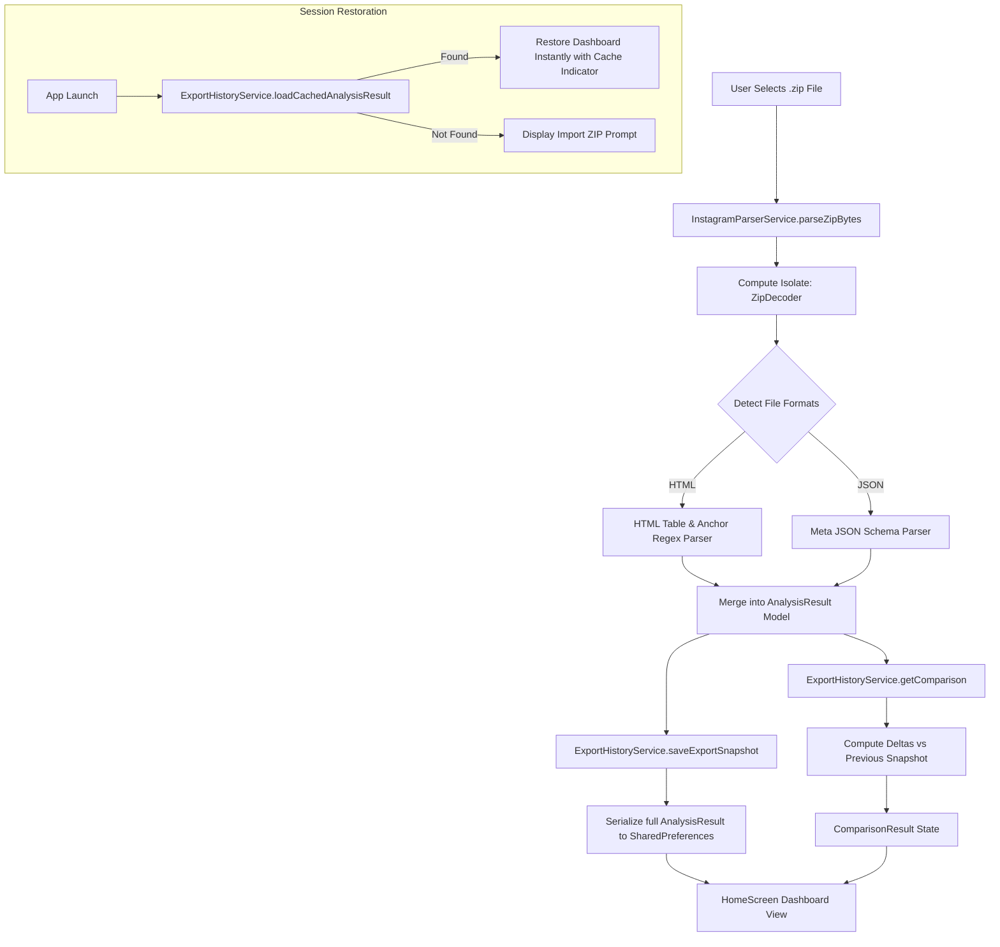

# UnInsta — Project Structure & Architecture

## Overview
**UnInsta** is an offline-first, privacy-respecting Instagram analytics tool built with Flutter. It analyzes official Instagram data exports (`.zip` archives in HTML or JSON format) to uncover insights about follower dynamics without requiring account credentials, OAuth tokens, or external server uploads.

---

## Directory Tree

```
UnInsta/
├── android/                        # Native Android configuration & manifest
├── ios/                            # Native iOS configuration & Runner
├── web/                            # Web configuration
├── windows/                        # Windows desktop runner
├── macos/                          # macOS desktop runner
├── linux/                          # Linux desktop runner
├── test/                           # Unit & widget tests
│   └── widget_test.dart
├── lib/                            # Dart / Flutter application source code
│   ├── main.dart                   # Application entry point & theme orchestrator
│   ├── models/                     # Strongly-typed data models
│   │   └── instagram_models.dart   # InstagramUser, AnalysisResult, ComparisonResult
│   ├── services/                   # Business logic, background compute & persistence
│   │   ├── instagram_parser_service.dart   # ZIP archive unpacking & parsing engine
│   │   ├── export_history_service.dart    # Snapshot delta engine & SharedPreferences cache
│   │   └── instagram_avatar_service.dart  # 3-Layer resilient avatar resolution service
│   ├── theme/                      # Visual design system & styling
│   │   └── app_theme.dart          # Light/Dark palettes, typography & card styles
│   ├── widgets/                    # Reusable UI components
│   │   ├── instagram_avatar.dart   # 3-Layer avatar widget with gradient monogram fallback
│   │   ├── stat_summary_card.dart  # Compact statistic counter cards with active indicators
│   │   └── user_card.dart          # Follower/following list tile with action triggers
│   └── screens/                    # Application screens & navigation targets
│       ├── home_screen.dart        # Main dashboard, tab navigation, search & filter chips
│       ├── lost_followers_screen.dart     # Detailed snapshot comparison: who unfollowed me
│       └── unfollowed_by_me_screen.dart   # Accounts unfollowed by the user
├── pubspec.yaml                    # Package dependencies, assets & app metadata
├── analysis_options.yaml           # Linting rules & static analysis configuration
├── LICENSE                         # GNU General Public License v3.0 (GPL-3.0)
├── structure.md                    # This architectural and structural reference
├── ai_instructions.md              # Engineering guidelines and conventions for AI assistants
└── changelog.md                    # Release history and roadmap
```

---

## Architecture & Data Flow Pipeline



---

## Core Components Breakdown

### 1. Presentation Layer (`lib/screens/` & `lib/widgets/`)

#### [`HomeScreen`](file:///c:/Projects/UnInsta/lib/screens/home_screen.dart)
The central operational screen:
- **Session Auto-Restoration**: Automatically restores previously parsed data from disk on startup without requiring re-uploading.
- **Top Status Banner**: Displays export metadata (`@username`, export date, cached badge, quick-switch buttons).
- **Comparison Quick Banners**: Prominent indicators for "Who Unfollowed Me" and "Unfollowed by Me" with badge counts.
- **Horizontal Metric Tabs**: Quick switching across 6 segments:
  1. *Don't Follow Back* (Non-mutual followings)
  2. *Pending Requests* (Outbound follow requests not yet accepted)
  3. *Fans* (Accounts following you that you do not follow back)
  4. *Mutuals* (Two-way mutual followers)
  5. *Following* (All accounts you follow)
  6. *Followers* (All accounts following you)
- **Search & Filter Bar**:
  - Live search input matching usernames and display names.
  - Date Range filter chips (`All Time`, `< 30 Days`, `< 6 Months`, `< 1 Year`, `> 1 Year`).
  - Mutual filter toggle chip (for Followers and Following tabs).
  - Multi-criteria sorting (Newest Date, Oldest Date, Alphabetical A-Z, Alphabetical Z-A).

#### [`LostFollowersScreen`](file:///c:/Projects/UnInsta/lib/screens/lost_followers_screen.dart)
Compares the current export against the previous export stored in `ExportHistoryService`:
- Detects users present in the previous followers list but absent from the current followers list.
- Highlights accounts that unfollowed you between export dates.

#### [`UnfollowedByMeScreen`](file:///c:/Projects/UnInsta/lib/screens/unfollowed_by_me_screen.dart)
Displays accounts the user recently unfollowed:
- Combines Instagram's internal `recently_unfollowed_profiles` log with calculated diffs between sequential snapshots.

#### [`InstagramAvatar`](file:///c:/Projects/UnInsta/lib/widgets/instagram_avatar.dart)
A self-healing avatar widget implementing a **3-Layer Fallback Architecture**:
1. **Layer 1 (Direct CDN / Web Profile API)**: Attempts to load the user's authentic Instagram avatar via official web profile metadata.
2. **Layer 2 (Public Proxy Mirror)**: If Layer 1 returns 404, 429, or fails to decode, silently falls back to an external avatar mirror (`ui-avatars.com`).
3. **Layer 3 (Deterministic Instagram Gradient Monogram)**: If the device is offline or all network endpoints fail, renders an instant, high-contrast initial monogram with a deterministic gradient hue derived from the username's hash code.

---

### 2. Service & Engine Layer (`lib/services/`)

#### [`InstagramParserService`](file:///c:/Projects/UnInsta/lib/services/instagram_parser_service.dart)
- Executes ZIP decoding in a dedicated background `compute` isolate to avoid blocking the main UI thread.
- Automatically handles both newer JSON-based exports and classic HTML-based exports generated by Meta Accounts Center.
- Extracts account owner and generation timestamp from export metadata.
- Computes set operations (`difference`, `intersection`) to segment non-followers, fans, and mutuals.

#### [`ExportHistoryService`](file:///c:/Projects/UnInsta/lib/services/export_history_service.dart)
- **Snapshot Archiving**: Manages two rolling snapshots: `current` and `previous`. When a newer export is imported, the existing current snapshot transitions to previous.
- **Session Caching**: Serializes the complete `AnalysisResult` JSON into `uninsta_cached_analysis_result` so the app re-opens with immediate state fidelity.
- **Comparison Engine**: Calculates lost followers, gained followers, and unfollowed accounts between any two exports.

#### [`InstagramAvatarService`](file:///c:/Projects/UnInsta/lib/services/instagram_avatar_service.dart)
- Singleton service managing in-memory caching and in-flight request deduplication.
- Concurrency limiter ensuring at most 4 concurrent network requests to prevent socket saturation.
- Multi-tier resolution:
  - Memory cache lookup $\rightarrow$ Local storage cache lookup $\rightarrow$ Instagram Web Profile API (`api/v1/users/web_profile_info/`) $\rightarrow$ OpenGraph Crawler $\rightarrow$ Public Proxy Fallback.

---

### 3. Data Models (`lib/models/instagram_models.dart`)

- **`InstagramUser`**:
  - `username`: Clean Instagram username.
  - `displayName`: Optional display name parsed from HTML/JSON.
  - `date`: Human-readable string date from the export.
  - `url`: Direct profile link (`https://www.instagram.com/<username>`).
  - `parsedDate`: Standardized `DateTime` instance for date comparisons and sorting.
  - `toJson()` / `fromJson()`: Complete serialization support.
- **`AnalysisResult`**:
  - Complete representation of an export's processed data: `followers`, `following`, `notFollowingBack`, `fans`, `mutual`, `pendingRequests`, `recentlyUnfollowedByMe`, `accountOwner`, `exportDate`.
  - Full JSON serialization for persistent local storage.
- **`ComparisonResult`**:
  - Represents differences between two exports: `lostFollowers`, `unfollowedByMe`, `newFollowers`, `newFollowing`, `previousExportDate`, `currentExportDate`.

---

## Local Storage & SharedPreferences Keys

| Key | Type | Description |
|---|---|---|
| `uninsta_cached_analysis_result` | String (JSON) | Complete serialized `AnalysisResult` for instant startup restoration |
| `uninsta_current_snapshot` | String (JSON) | Current follower/following list snapshot for delta comparisons |
| `uninsta_previous_snapshot` | String (JSON) | Historical follower/following snapshot for calculating unfollowers |
| `ig_avatar_<username>` | String (URL) | Cached direct CDN profile picture URL for individual usernames |

---

## Suggested Must-Have Features Roadmap

1. **Protected / Whitelisted Accounts**:
   - Star/whitelist specific accounts (brands, creators, news) so they never appear in the "Don't Follow Back" list.
2. **Export to CSV / Clipboard**:
   - One-tap button to copy all unfollower usernames to clipboard or export a clean `.csv` report.
3. **In-App Meta Export Tutorial**:
   - Built-in visual walkthrough demonstrating how to request the exact ZIP package from Meta Accounts Center.
4. **Multi-Export Historical Timeline**:
   - Longitudinal tracker to plot follower gain/loss graphs across months of exports.
